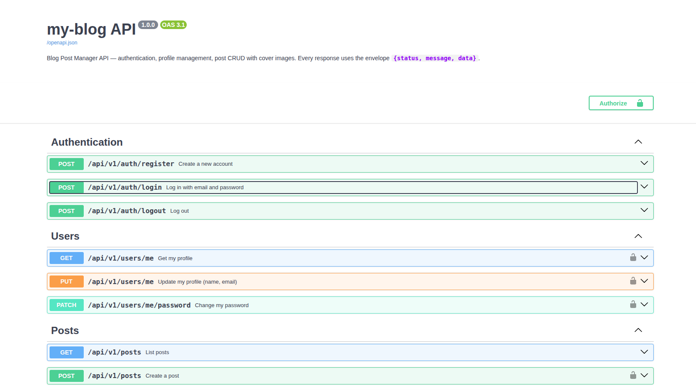

# my-blog — Blog Post Manager

Full-stack blog post manager built for the **Fintrellis technical assignment**.

| Layer    | Stack |
|----------|-------|
| Backend  | Python 3.12, FastAPI, SQLAlchemy 2.0 (async), Alembic, Pydantic v2, PyJWT, Argon2, Pillow, Pytest, uv |
| Frontend | Next.js 16 (App Router), React 19, TypeScript, Tailwind CSS 4, React Hook Form, Zod, Sonner |
| Infra    | PostgreSQL 16, Docker, Docker Compose |

**Full documentation** (features, architecture, API reference, migrations, tests, security):
[project-docs/document.md](./project-docs/document.md)

## Getting started

**Prerequisites:** Docker 24+ with Docker Compose v2.

1. Clone the repository:

   ```bash
   git clone <repository-url>
   cd my-blog
   ```

2. Create the `.env` file from the example and adjust the values if needed
   (secrets, ports, URLs):

   ```bash
   cp .env.example .env
   ```

   > If you change `BACKEND_PORT`, also update `NEXT_PUBLIC_API_URL`, `PUBLIC_API_URL` and
   > `CORS_ORIGINS`. If you change `FRONTEND_PORT`, update `CORS_ORIGINS`.

3. Build and start the application:

   ```bash
   docker compose up --build
   ```

Stop it with `docker compose down`, and follow the logs with `docker compose logs -f`.

## URLs

With the default ports:

| Service              | URL                            |
|----------------------|--------------------------------|
| Frontend             | <http://localhost:3005>        |
| API                  | <http://localhost:8005/api/v1> |
| API docs (ReDoc)     | <http://localhost:8005/redoc>  |
| API docs (Swagger UI)| <http://localhost:8005/docs>   |


